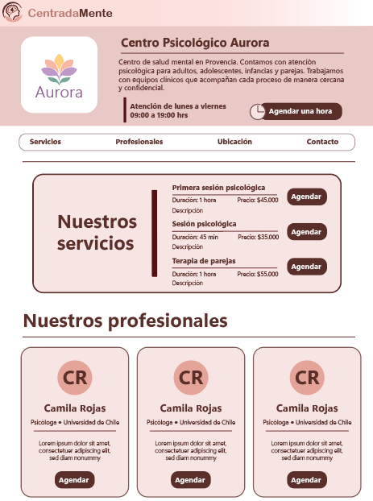
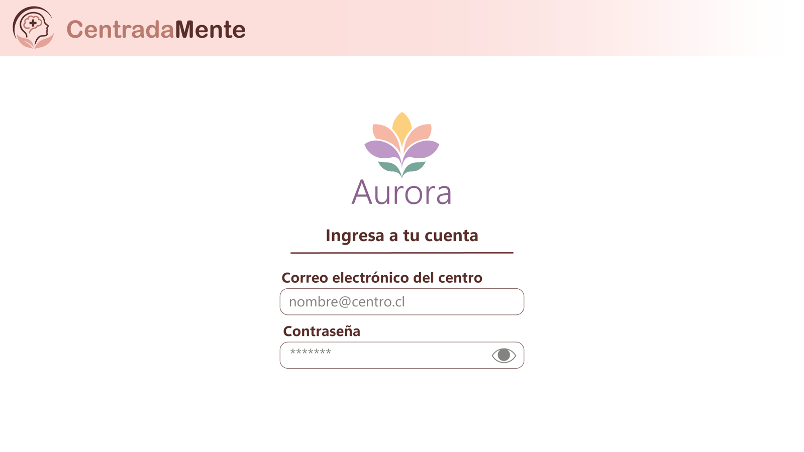

# CentradaMente

Agendamiento y gestión de permisos para centros de salud.

- Web: https://encuadrado.vercel.app
- API: https://encuadrado-api.onrender.com/api/health/ (plan gratuito: la primera petición puede tardar cerca de un minuto)

## Accesos

Contraseña de todos los usuarios: `encuadrado2026`

| Correo | Rol |
|---|---|
| camila@aurora.cl | Administrador en Centro Aurora |
| matias@aurora.cl | Profesional en Centro Aurora |
| recepcion@aurora.cl | Solo lectura en Centro Aurora |
| valentina@aurora.cl | Profesional en Centro Aurora y Administrador en Clínica Nutrir |
| francisca@nutrir.cl | Administrador en Clínica Nutrir |
| diego@nutrir.cl | Profesional en Clínica Nutrir |
| recepcion@nutrir.cl | Solo lectura en Clínica Nutrir |

Perfiles públicos: `/c/centro-aurora` y `/c/clinica-nutrir`.

## Correr en local

Stack: Next.js 16 + TypeScript + shadcn/ui (web), FastAPI + SQLAlchemy + Alembic (API), Postgres en Neon.

### 1. Instalar herramientas (una sola vez)

- [Git](https://git-scm.com/downloads)
- [uv](https://docs.astral.sh/uv/getting-started/installation/), el gestor de Python. Descarga Python 3.15 por su cuenta al instalar la API, no hace falta instalarlo aparte.
  - macOS / Linux: `curl -LsSf https://astral.sh/uv/install.sh | sh`
  - Windows (PowerShell): `powershell -ExecutionPolicy ByPass -c "irm https://astral.sh/uv/install.ps1 | iex"`
- [Node.js](https://nodejs.org) 20.9 o superior (versión LTS).
- pnpm: `npm install -g pnpm`

No se necesita instalar Postgres: la base de datos está en Neon (en la nube) y ya tiene las tablas y los datos de prueba.

### 2. Clonar el repositorio

```bash
git clone https://github.com/Gonz1n/Proyecto-Encuadrado.git
cd Proyecto-Encuadrado
```

### 3. Levantar la API (terminal 1)

```bash
cd api
cp .env.example .env
```

Abrir `api/.env` y reemplazar `DATABASE_URL` por la URL enviada en el correo de entrega. `TEST_DATABASE_URL` solo se usa para correr las pruebas.

```bash
uv sync                           # instala Python 3.15 y las dependencias
uv run alembic upgrade head       # crea las tablas si faltan
uv run python -m app.db.seed      # carga los datos de prueba si faltan
uv run fastapi dev app/main.py    # http://localhost:8000
```

Dejar esta terminal abierta. Para comprobar que funciona, abrir http://localhost:8000/api/health/ (debe responder `{"status":"ok"}`).

### 4. Levantar la web (terminal 2)

Desde la raíz del repositorio:

```bash
cd web
cp .env.example .env.local        # API_URL=http://localhost:8000, no hay que cambiarlo
pnpm install
pnpm dev                          # http://localhost:3000
```

### 5. Usar la aplicación

Abrir http://localhost:3000 e ingresar con cualquier usuario de la tabla de [Accesos](#accesos). El perfil público de los centros está en http://localhost:3000/c/centro-aurora.

### Pruebas

- API: `uv run pytest -q` en `api/`. Requiere `TEST_DATABASE_URL` apuntando a una base distinta de `DATABASE_URL`, porque las pruebas borran y recrean las tablas.
- Web: `pnpm check` en `web/` (lint, tipos y pruebas).

Deploy: Render usa `render.yaml` y en cada arranque aplica migraciones y seed. Vercel despliega `web/` con la variable `API_URL`.

## Cómo se cumple cada requisito

### Plataforma para el profesional

**Login y logout.** Se ingresa con correo y contraseña, y el botón de salir cierra la sesión. Sin sesión, `web/src/proxy.ts` redirige al login y vuelve a la página pedida al ingresar.

**Roles.** Administrador, Profesional y Solo lectura. El rol del usuario en el centro actual se muestra junto a su nombre en el menú.

**Restricción de accesos.** La API valida el rol en cada endpoint y responde 403 si no tiene permiso, o 404 si el usuario no pertenece al centro. La web oculta o deshabilita las acciones que el rol no permite y muestra el mensaje de la API si una acción es rechazada.

**Ver agendamientos.** Cada cita muestra paciente (nombre, teléfono y correo), fecha y hora, servicio y profesional. El administrador y Solo lectura ven todo el centro y pueden filtrar por profesional; el Profesional ve solo sus citas, filtradas en la API.

**Configuración del centro.** El administrador edita nombre, descripción (máximo 400 caracteres), horario de inicio y término, días de atención y hora de almuerzo. Los demás roles ven la configuración en modo lectura.

**Servicios.** El administrador agrega, edita y elimina servicios con nombre, precio en CLP y duración propia. Todos los profesionales ofrecen todos los servicios. El seed crea tres servicios por centro.

**Reagendar y cancelar (deseable).** El administrador puede hacerlo con cualquier cita y el profesional con las suyas, con una nota opcional. Cada cambio queda en el historial de la cita.

**Agregar un agendamiento (deseable).** El botón "Agendar hora" permite elegir servicio, profesional, modalidad, día, hora y datos del paciente. El profesional solo puede agendar para sí mismo.

**Agenda en calendario (deseable).** Vistas de semana, día y lista, con un color por profesional.

### Vista del paciente

**URL pública.** `/c/<slug-del-centro>`, sin autenticación.

**Datos del centro.** Nombre, descripción, horario, servicios con precio y duración, profesionales con su perfil, ubicación con mapa y contacto.

**Elegir servicio o profesional primero.** El paciente parte por cualquiera de los dos y luego elige el otro. Si parte por profesional, puede venir directo desde su tarjeta en el perfil.

**Horas disponibles.** Se calculan según la duración del servicio, el horario del centro, la hora de almuerzo, los días cerrados y las citas del profesional en cualquier centro. Se ofrecen en bloques de 30 minutos, desde mañana hasta 30 días después.

**Datos del paciente.** Nombre, correo, teléfono, RUT y fecha de nacimiento, más la modalidad presencial o remota. Los errores se muestran en cada campo y al confirmar se llega a una pantalla de éxito con el resumen.

**Términos y condiciones (deseable).** Para reservar hay que aceptar los TyC, que se leen en un diálogo, y autorizar el tratamiento de datos según la Ley 21.719. Se guarda la fecha de ambas aceptaciones y el administrador edita el texto en Configuración.

### Bonus

**Varios centros.** Hay dos centros. Valentina pertenece a ambos con roles distintos y cambia de centro desde el menú. Los permisos se evalúan según su rol en cada centro.

**Base de datos en la web.** Postgres en Neon. Los cambios se mantienen entre despliegues porque el seed solo crea lo que falta.

## Supuestos

- El paciente no tiene cuenta: sus datos se guardan en la cita. Por eso no puede reagendar ni cancelar por su cuenta; lo hace el centro.
- Pedimos RUT y fecha de nacimiento porque un centro de salud necesita identificar al paciente para su ficha clínica.
- Solo lectura no atiende pacientes, por eso no aparece como profesional para reservar.
- Un profesional no puede tener dos citas a la misma hora, aunque sean en centros distintos. Si dos pacientes piden la misma hora a la vez, la API bloquea la fila del profesional y el segundo recibe un aviso para elegir otra.
- La ventana móvil de 30 días reemplaza el "cierto mes" de la pauta, para que siempre haya horas sin importar cuándo se pruebe.
- Las horas se manejan en hora de Chile, sin soporte para otras zonas horarias.
- Eliminar un servicio lo desactiva en vez de borrarlo, para no perder las citas que ya lo usan.
- Marcar un día como cerrado cancela las citas de ese día y deja la razón en su historial.

## Decisiones que destaco

- Destaco el diseño web que tiene la plataforma completa, es fácil de usar e incita al usuario a mirar todas las opciones que tiene la plataforma. Se adjuntan algunas imágenes de cómo se planeó usando Illustrator.

- Se destaca el manejo de roles para una persona que trabaja en dos centros a la vez.

**Perfil público del centro**



**Inicio de sesión**


